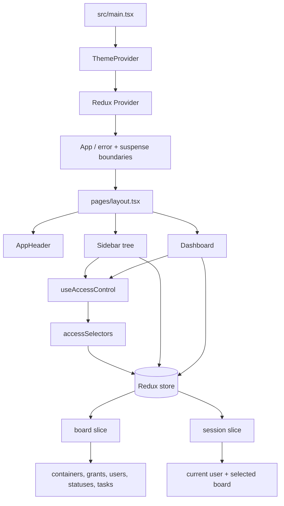

# FlowBoard

FlowBoard is a Vite + React + TypeScript kanban-style application. It provides a workspace directory, permission-filtered spaces/folders/boards, task views, task details, drag-and-drop ordering, and task archival.

## Run locally

```bash
npm install
npm run dev
```

Then open the local URL printed by Vite.

Useful checks:

```bash
npm run lint
npm run build
npm run test
npm run test:e2e
```

The app uses seeded, in-memory data. There is no backend or persistence layer in this phase; refreshing the page resets the session to the seed data.

## Architecture



The main boundaries are:

- `src/main.tsx` bootstraps the app, theme provider, and Redux provider.
- `src/pages/layout.tsx` composes the header, sidebar, and dashboard.
- The sidebar renders the workspace → space → folder → board hierarchy.
- The dashboard owns board, list, archived-task, and task-detail presentation.
- Redux owns domain state and mutation validation. React hooks own transient UI state such as open dialogs, selected views, and drag state.
- `useAccessControl` is the shared React boundary for access decisions. Pure access logic lives in `src/store/access.ts`; visible-tree selectors live in `src/store/selectors/accessSelectors.ts`.

## Data model

The directory model is hierarchical:

```text
Workspace
└── Space[]
    └── Folder[]
        └── Board[]
            ├── Status[]
            └── Task[]
                └── Subtask[]
```

- Containers represent spaces, folders, and boards. Boards are the primary task lists.
- Each board has statuses such as ToDo, In-progress, and Done.
- Tasks belong to one primary board and one status, have an indexed `position`, and may have one level of subtasks through `parentTaskId`.
- Tasks use `archivedAt: string | null` for soft deletion/archive. Active views filter out archived tasks; the archived view shows them. Archiving a parent also archives its one-level subtask tree. Unarchiving restores the tree to the board’s ToDo status.
- Users include seeded admin/member accounts. Grants associate users with resources using `allow` or `deny` modes. Deny takes precedence for a matching resource.
- The `board` slice stores containers, statuses, tasks, users, grants, and mutation feedback. The `session` slice stores the current user and selected board.

## Permissions and user switching

Permission checks are enforced in the store and selectors, not only by hiding UI controls.

- `accessSelectors` derives the visible spaces, folders, and boards from the current user, all containers, and grants.
- Reducer mutations validate access again before creating, editing, deleting, moving, archiving, or restoring content. Forbidden mutations produce a 403-style error/feedback event.
- Admins bypass resource access checks. Non-admin access follows the workspace-to-resource chain: public resources are visible to workspace members unless explicitly denied; private resources require an allow grant.
- The UI consumes selector-derived data, so switching the current user immediately recalculates the tree, selected-board access, and dashboard content. If the previous selection is no longer accessible, the app resolves the first accessible board or displays the stale-selection access feedback.
- Container permission fields can be edited only by administrators. Space creation grants the creator access, and members can create descendants under spaces they can access.

The current model intentionally has user-level grants only. To add team-based grants, extend a grant with a subject type and subject ID, for example `subjectType: "user" | "team"` and `subjectId`. The selectors can resolve team membership before applying the same allow/deny predicate; team inheritance and nested teams are not implemented yet.

## Archive decision

Tasks use soft delete/archive rather than destructive deletion. An archive timestamp preserves the task and allows an explicit archived view and restore flow. This keeps accidental deletion recoverable and makes archived work distinguishable from active work without introducing a separate persistence service.

Container deletion remains a separate destructive in-memory operation: deleting a folder or board cascades through its descendants, statuses, tasks, and grants. Space deletion is not exposed in the current sidebar UI.

## Trade-offs and week 2

For this phase, the implementation prioritizes a complete client-side interaction model and permission behavior over backend concerns.

Cut or deferred:

- API integration, authentication, persistence, and multi-device synchronization.
- Team-based grants, complex inheritance, nested teams, and server-side authorization.
- A full audit log, bulk task operations, advanced search/filtering, and production-grade pagination.
- Persistent sidebar/navigation state and a full collaboration/realtime layer.

In week 2, the client-focused next steps would be:

1. Strengthen permission-aware client state so every user switch, stale selection, and denied mutation produces a consistent tree, board, and feedback state.
2. Add more complete client-side persistence boundaries, including loading, empty, error, and retry states around the current store so a future API can be introduced without changing presentation components.
3. Improve task workflows with richer filtering/search, bulk archive/restore, clearer active-versus-archived affordances, and more resilient drag/drop behavior.
4. Expand accessibility coverage for keyboard navigation, dialogs, accordions, task interactions, user switching, and drag/drop alternatives.
5. Add focused unit and end-to-end coverage for permission transitions, archive/restore, cross-status moves, same-status reordering, responsive layouts, and optimistic-update rollback behavior.

## AI usage log

- Codex was used to inspect the repository, read the project architecture/context files, and draft this README.
- The FlowBoard repository skill was used to follow the repository’s documentation and verification conventions.
- AI assistance helped organize the architecture diagram and explain the existing store, selectors, archive behavior, and trade-offs.
- The generated content was checked against the source tree, reducer/selectors, tests, package scripts, and architecture notes. Corrections included replacing the default Vite README, documenting the actual in-memory/seed-data limitation, describing reducer-level permission enforcement, and recording the existing one-level subtask archive behavior rather than assuming a backend or permanent delete model.
- No external AI tools or external data sources were used for the README.

## Drag-and-drop note

The board uses native HTML5 drag-and-drop behavior. Drops carry an explicit insertion index; reducers normalize positions in the source and destination status. Kanban columns allow cross-status moves, while list-view reordering is restricted to the current status group.

The only intentional style exception is the drag interaction’s temporary opacity change on the active card while it is being dragged. It is a visual state, not a separate drag-and-drop library or custom layout system.
